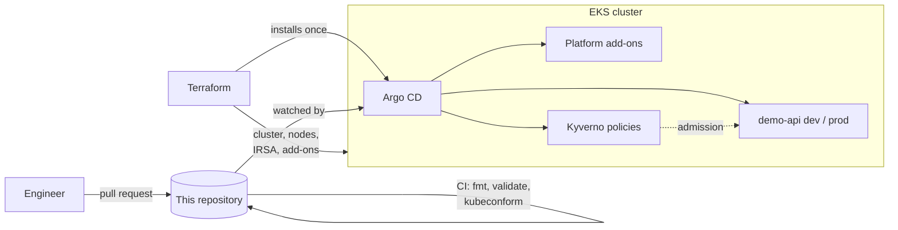

# EKS GitOps platform

[](https://github.com/pavangajjala/eks-gitops-platform/actions/workflows/ci.yml)

A Kubernetes platform on Amazon EKS where Terraform builds the cluster and
Argo CD runs everything inside it from this repository.



## What is in here

| Path | Contents |
| --- | --- |
| `terraform/cluster` | EKS control plane, managed node groups, KMS secrets encryption, access entries, IRSA roles, managed add-ons |
| `terraform/bootstrap` | Installs Argo CD and the root Application, then steps back |
| `gitops/bootstrap` | Argo CD projects, the platform and policy Applications, the ApplicationSet for apps |
| `gitops/platform` | cert-manager, metrics-server, Kyverno, External Secrets, Traefik, kube-prometheus-stack |
| `gitops/policies` | Kyverno admission policies |
| `gitops/apps/demo-api` | Example workload with Kustomize overlays for dev and prod |
| `scripts/validate.sh` | Renders every overlay and validates all manifests |

## Design decisions

**Terraform stops at Argo CD.** Terraform owns AWS resources and installs
Argo CD. It does not manage Helm releases for add-ons or any workload. That
keeps Kubernetes objects out of Terraform state and gives one answer to "what
is running and why": the `gitops/` directory.

**No cluster-admin by accident.** The cluster uses EKS access entries. The
identity that runs Terraform is not granted admin implicitly, and admin access
is an explicit list of IAM roles.

**Private by default.** The API endpoint is private unless CIDR ranges are
listed, and a variable validation rejects `0.0.0.0/0`. Nodes sit in private
subnets and are reached through Session Manager. The ingress load balancer is
internal.

**Least-privilege AWS access for pods.** Each service account that needs AWS
gets its own IAM role, trusted only for that namespace and service account.
External Secrets can read only secrets under the cluster's prefix.

**Guardrails for application teams.** The `apps` Argo CD project can deploy
only to `demo-*` namespaces and cannot create cluster-scoped resources.
Kyverno rejects privileged or root containers, missing requests and memory
limits, and unpinned images. Namespaces enforce the `restricted` Pod Security
standard as a second layer.

**Promotion is a pull request.** Dev syncs automatically on merge. Prod is on
manual sync, and changing the image tag in `overlays/prod` is the promotion.

## Usage

Prerequisites: Terraform 1.10+, AWS CLI, an existing VPC with private subnets
(for example from [aws-landing-zone](https://github.com/pavangajjala/aws-landing-zone)).

```bash
# 1. Cluster
cd terraform/cluster
cp example.tfvars dev.auto.tfvars        # edit VPC, subnets and admin roles
terraform init -backend-config=...       # your S3 backend settings
terraform plan -out tfplan && terraform apply tfplan

# 2. Argo CD and the root Application
cd ../bootstrap
terraform init -backend-config=...
terraform apply -var cluster_name=platform-dev

# 3. Watch Argo CD bring up the platform
aws eks update-kubeconfig --name platform-dev
kubectl -n argocd get applications
```

If you fork this, change `repoURL` in `gitops/bootstrap/*.yaml` and the
`gitops_repo_url` variable to your fork, and replace the placeholder account
ID in `gitops/platform/external-secrets.yaml`.

## Validation

```bash
./scripts/validate.sh          # needs kustomize and kubeconform
```

CI runs this on every pull request together with `terraform fmt` and
`terraform validate`. Manifests are checked in strict mode against the
Kubernetes schemas and the published CRD schemas for Argo CD and Kyverno.

## Status

Terraform passes `validate` and every manifest passes schema validation. The
VPC IDs, account IDs and role ARNs in the examples are placeholders, and chart
versions are pinned to what was current when this was written; Renovate is
configured to keep them moving.

More background is in [docs/decisions.md](docs/decisions.md).

## License

MIT
